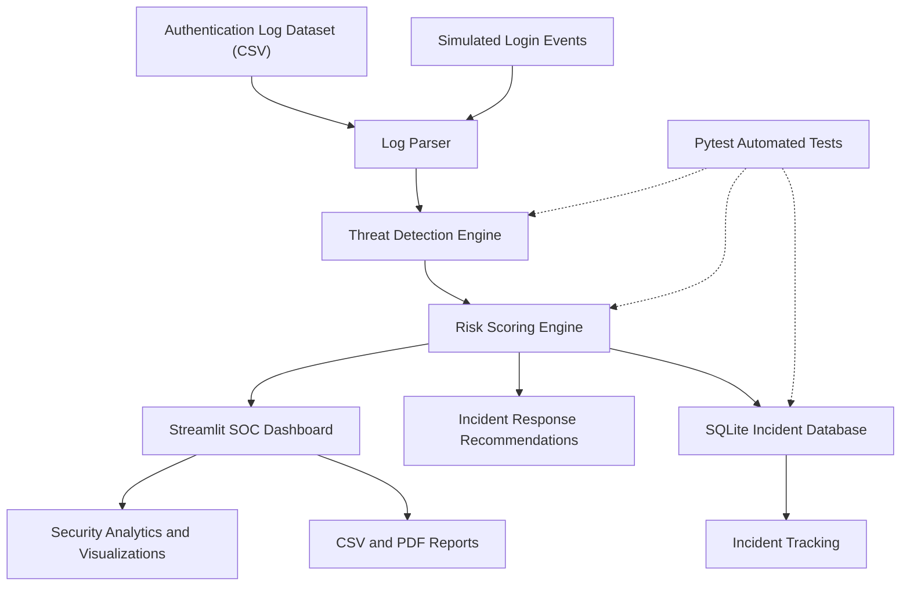

# 🛡️ SOC Sentinel – Security Operations Center Monitoring System

**SOC Sentinel** is a Python-based Security Operations Center (SOC) monitoring application designed to analyze authentication logs, detect suspicious login activities, calculate security risk scores, and track security incidents through an interactive dashboard.

## 🚀 Project Overview

SOC Sentinel helps security teams identify potential threats by monitoring login activities and analyzing authentication logs.

The application detects suspicious patterns, categorizes threats based on risk levels, and provides incident response recommendations.

## ✨ Key Features

- **Authentication Log Monitoring:** Analyze login events from CSV datasets.
- **Brute Force Detection:** Identify repeated failed login attempts.
- **Password Spraying Detection:** Detect attempts targeting multiple user accounts from one IP address.
- **Suspicious Login Detection:** Identify successful logins following repeated failures.
- **High-Volume Failed Login Detection:** Detect unusually high failed login activity.
- **Risk Scoring:** Assign numerical risk scores and classify alerts as HIGH or CRITICAL.
- **Interactive Dashboard:** Visualize login activities, alerts, and security statistics.
- **IP Address Investigation:** Investigate IP addresses associated with suspicious activity.
- **Incident Management:** Store incidents and track their status using SQLite.
- **Response Recommendations:** Provide suggested actions for detected threats.
- **PDF Reports:** Generate downloadable security reports.
- **Login Simulation:** Simulate login attempts and observe detection results.
- **Automated Testing:** Validate threat detection, risk scoring, and incident management.

## 🛠️ Technologies Used

| Technology | Purpose |
|---|---|
| Python | Core programming |
| Streamlit | Interactive dashboard |
| Pandas | Log processing and analysis |
| Plotly | Data visualization |
| SQLite | Incident management |
| Pytest | Automated testing |
| ReportLab | PDF report generation |

## 📂 Project Structure

```text
SOC/
│
├── app.py
├── requirements.txt
├── README.md
├── incidents.db
│
├── data/
│   └── sample_auth_logs.csv
│
├── src/
│   ├── __init__.py
│   ├── log_parser.py
│   ├── detection_engine.py
│   ├── risk_scoring.py
│   ├── report_generator.py
│   ├── response_recommendations.py
│   └── incident_database.py
│
├── tests/
│   ├── __init__.py
│   ├── test_detection.py
│   └── test_incident_database.py
│
└── reports/
```

## ⚙️ Installation and Setup

### 1. Clone the repository

```bash
git clone https://github.com/YOUR_USERNAME/SOC-Sentinel.git
```

### 2. Navigate to the project folder

```bash
cd SOC-Sentinel
```

### 3. Create a virtual environment

```bash
python -m venv venv
```

### 4. Activate the virtual environment

**Windows:**

```bash
venv\Scripts\activate
```

### 5. Install dependencies

```bash
pip install -r requirements.txt
```

### 6. Run the application

```bash
streamlit run app.py
```

## 🧪 Running Automated Tests

Run the following command to execute the test suite:

```bash
python -m pytest -v
```

The tests cover:

- Brute force attack detection
- Password spraying detection
- Suspicious successful login detection
- Risk scoring
- Incident storage
- Incident status updates

## 🔍 Threat Detection Mechanisms

| Threat | Detection Approach |
|---|---|
| Brute Force Attack | 5 or more failed attempts by the same user and IP within 5 minutes |
| Password Spraying | One IP targeting 5 or more unique accounts |
| Suspicious Successful Login | Successful login following 3 or more failures within 10 minutes |
| High Volume Failed Logins | 8 or more failed attempts from one IP within 10 minutes |

## 📊 Dashboard Modules

1. Security Alert Summary
2. Login Statistics
3. Latest Login Events
4. Login Attack Simulator
5. Security Alert Investigation
6. Incident Response Recommendations
7. Incident Response Tracking
8. IP Address Investigation
9. Security Analytics and Visualizations
10. CSV and PDF Report Downloads

## 🔐 Security Note

This project is an educational SOC monitoring prototype that uses sample authentication logs and simulated login events.

It does not currently monitor live enterprise network traffic, automatically block IP addresses, or perform real account remediation.

The demonstration login credentials should be replaced with secure authentication before any production deployment.

## 🎯 Project Objective

The objective of SOC Sentinel is to demonstrate how security monitoring, authentication log analysis, threat detection, risk assessment, incident tracking, and reporting can be integrated into a single dashboard.


## 🏗️ Project Architecture

The following diagram illustrates the workflow of SOC Sentinel, from authentication log collection to threat detection, risk assessment, and incident management.




